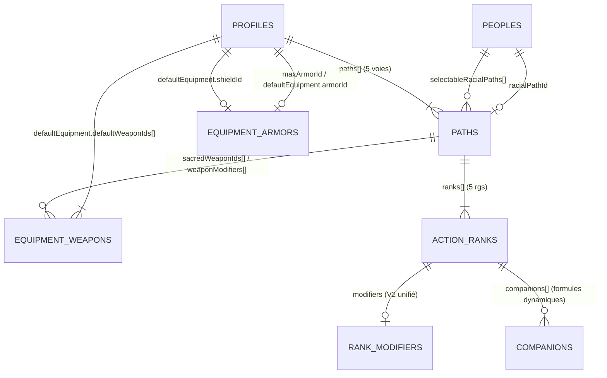

# 📚 Documentation des Modèles de Données JSON (Schéma V2 — COF2 Compagnon)

Ce guide documente de manière exhaustive la structure des **5 fichiers de données statiques** situés dans [`src/data/`](file:///c:/Users/egagnon/Personnel/Dev/COF2/src/data) (Version 2 déclarative) afin d'en faciliter l'édition, la maintenance et l'extension sans jamais avoir à coder de cas particuliers dans [`src/engine/rulesEngine.ts`](file:///c:/Users/egagnon/Personnel/Dev/COF2/src/engine/rulesEngine.ts).

---

## 🔗 Vue d'Ensemble & Relations entre les Fichiers



| Fichier | Rôle dans le moteur | Type TypeScript associé ([`src/types/cof2.ts`](file:///c:/Users/egagnon/Personnel/Dev/COF2/src/types/cof2.ts)) |
| :--- | :--- | :--- |
| [`equipment.json`](file:///c:/Users/egagnon/Personnel/Dev/COF2/src/data/equipment.json) | Hiérarchie d'armures, armures/boucliers, armes avec tags déclaratifs et kit de départ | `ArmorItem`, `WeaponItem`, `WeaponTag` |
| [`peoples.json`](file:///c:/Users/egagnon/Personnel/Dev/COF2/src/data/peoples.json) | Peuples jouables, modificateurs raciaux, référence `racialPathId` et contraintes morphologiques | `PeopleData`, `PeopleEquipmentRules` |
| [`profiles.json`](file:///c:/Users/egagnon/Personnel/Dev/COF2/src/data/profiles.json) | Profils de héros, dés de vie, règles de maîtrise d'équipement, pénalités d'armure de sort et voies associées | `ProfileData`, `ProfileEquipmentRule`, `ProfileWeaponRules` |
| [`paths.json`](file:///c:/Users/egagnon/Personnel/Dev/COF2/src/data/paths.json) | Toutes les voies (profil, peuple, domaine, prestige, générique), prérequis, rangs, `modifiers` V2 et compagnons | `PathData`, `ActionRank`, `RankModifiers`, `CompanionStatBlock` |
| [`tables.json`](file:///c:/Users/egagnon/Personnel/Dev/COF2/src/data/tables.json) | Tables aléatoires et référentiels d'aide à la création (idéaux, travers, coûts des caractéristiques) | `TablesData` |

---

## 1. 🛡️ `src/data/equipment.json`

Le fichier [`src/data/equipment.json`](file:///c:/Users/egagnon/Personnel/Dev/COF2/src/data/equipment.json) est un objet JSON racine contenant **4 clés principales** :

```json
{
  "armorHierarchy": ["tissus", "cuir-simple", "..."],
  "armors": [ ... ],
  "weapons": [ ... ],
  "startingAdventurerKit": [ ... ]
}
```

### 1.1. `armorHierarchy` (`string[]`)
Liste ordonnée des identifiants d'armures de la plus légère à la plus lourde.
> **Important :** Lorsqu'un profil définit `maxArmorId: "cuir-renforce"`, le moteur autorise automatiquement toutes les armures situées avant ou à cet index dans `armorHierarchy`.

### 1.2. `armors` (`ArmorItem[]`)

| Champ | Type | Requis | Description & Règles de remplissage |
| :--- | :--- | :---: | :--- |
| `id` | `string` | ✅ | Identifiant unique en `kebab-case` (ex: `"chemise-mailles"`, `"petit-bouclier"`). |
| `name` | `string` | ✅ | Nom affiché dans l'interface (ex: `"Chemise de mailles"`). |
| `def` | `number` | ✅ | Bonus de Défense octroyé par l'armure ou le bouclier (ex: `4`). |
| `maxAgi` | `number \| null` | ✅ | Bonus maximal d'AGI applicable à la DEF avec cette pièce. Mettre `null` s'il n'y a aucune limite (ex: boucliers, vêtements). |
| `price` | `string` | ✅ | Prix formaté avec devise (`"pa"`, `"po"`, `"pc"` ou `"—"`). |
| `type` | `"armor" \| "shield"` | ✅ | Distingue une armure corporelle (`"armor"`) d'un bouclier (`"shield"`). |
| `equivalentArmorId` | `string` | ❌ | Identifiant de l'armure de référence dans `armorHierarchy` pour vérifier l'autorisation de port par profil (ex: `"cuir-simple"` pour la `"cotte-ecorce"`). |
| `restrictedToPeopleIds` | `string[]` | ❌ | Liste d'identifiants de peuples auxquels cette armure est réservée (ex: `["satyre"]` pour `"cotte-ecorce"`). |
| `notes` | `string` | ❌ | Notes ou règles spéciales affichées sous le sélecteur et injectées dans les notes situationnelles (ex: `"Pas de malus en natation, mais doit être réparée après chaque combat ou perd 1 en DEF."`). |

### 1.3. `weapons` (`WeaponItem[]`)

| Champ | Type | Requis | Description & Règles de remplissage |
| :--- | :--- | :---: | :--- |
| `id` | `string` | ✅ | Identifiant unique en `kebab-case` (ex: `"epee-longue"`, `"arc-court"`). |
| `name` | `string` | ✅ | Nom complet de l'arme (ex: `"Épée longue"`). |
| `category` | `"contact" \| "distance"` | ✅ | Catégorie d'attaque principale (`"contact"` utilise FOR par défaut, `"distance"` utilise AGI). |
| `damage` | `string` | ✅ | Formule de dés de dommages affichée (ex: `"1d8"`, `"2d4"`, `"1d6"`). |
| `twoHandedDamage` | `string` | ❌ | Formule de dommages lorsque l'arme est maniée à 2 mains (pour les armes ayant le tag `"polyvalente"`, ex: `"1d10"` sur l'épée bâtarde). |
| `maxDamageDice` | `number` | ✅ | Valeur maximale d'un dé de base (ex: `8` pour `1d8`, `4` pour `2d4`, `12` pour `1d12` ou `2d6`). Utilisé par le moteur pour vérifier les plafonds de profils et de peuples de petite taille. |
| `damageType` | `"T" \| "P" \| "C" \| "T/P" \| "C/P"` | ✅ | Type de dégâts : **T**ranchant, **P**erforant, **C**ontondant. |
| `hands` | `1 \| 2` | ✅ | Nombre de mains requis en usage normal (`1` ou `2`). |
| `critMin` | `number` | ✅ | Seuil minimal naturel sur le d20 pour déclencher un coup critique (`20` par défaut, `19` pour rapière/vivelame, `18` pour kriss). |
| `tags` | `WeaponTag[]` | ✅ | Tags déclaratifs de l'arme utilisés par les profils et les voies. Valeurs possibles : `'legere'`, `'lancer'`, `'allonge'`, `'deux-mains'`, `'polyvalente'`, `'epee'`, `'sabre'`, `'hache'`, `'marteau'`, `'masse'`, `'lance'`, `'baton'`, `'arc'`, `'arbalete'`, `'poudre'`, `'fronde'`, `'mains-nues'`, `'escrime'`, `'duelliste'`, `'danseur'`, `'outil'`. |
| `range` | `string` | ❌ | Portée affichée pour les armes à distance ou lançables (ex: `"30 m"`, `"Contact (ou 10 m)"`). |
| `throwRange` | `string` | ❌ | Portée de lancer explicite pour une arme de contact ayant le tag `"lancer"` (ex: `"10 m"`). |
| `smallRaceReplacementId` | `string` | ❌ | Identifiant de l'arme de remplacement automatique lors de l'attribution de l'équipement de départ à un peuple de petite taille (ex: `"epee-courte"` sur `"rapiere"`). |
| `price` | `string` | ✅ | Prix de l'arme (ex: `"5 pa"`, `"12 po"`). |
| `notes` | `string` | ❌ | Propriétés textuelles affichées en rappel (ex: `"Critique 19-20, arme d'escrime et légère"`). |

#### Exemple complet (`WeaponItem` V2)
```json
{
  "id": "rapiere",
  "name": "Rapière",
  "category": "contact",
  "damage": "1d6",
  "maxDamageDice": 6,
  "damageType": "P",
  "hands": 1,
  "critMin": 19,
  "tags": ["legere", "epee", "escrime", "duelliste"],
  "smallRaceReplacementId": "epee-courte",
  "price": "5 pa",
  "notes": "Critique 19-20, arme d'escrime et légère"
}
```

---

## 2. 🧝 `src/data/peoples.json`

Le fichier [`src/data/peoples.json`](file:///c:/Users/egagnon/Personnel/Dev/COF2/src/data/peoples.json) contient un tableau `PeopleData[]` décrivant chaque peuple jouable. La voie raciale n'est jamais dupliquée dans `peoples.json` : elle est référencée via `racialPathId` et stockée dans [`paths.json`](file:///c:/Users/egagnon/Personnel/Dev/COF2/src/data/paths.json).

### 2.1. Structure d'un Peuple (`PeopleData`)

| Champ | Type | Requis | Description & Règles de remplissage |
| :--- | :--- | :---: | :--- |
| `id` | `string` | ✅ | Identifiant unique en `kebab-case` (ex: `"elfe-sylvain"`, `"ame-forgee"`). |
| `name` | `string` | ✅ | Nom affiché (ex: `"Elfe sylvain"`). |
| `source` | `"base" \| "compagnon"` | ✅ | Indique si le peuple provient du Livre de Base (`"base"`) ou du Compagnon (`"compagnon"`). Utilisé pour le filtre de l'assistant de création. |
| `description` | `string` | ✅ | Texte d'ambiance / lore du peuple. |
| `stats` | `Partial<Record<StatCode, number>>` | ❌ | Modificateurs raciaux **fixes** de caractéristiques (sans répétition).<br>• Ex (Elfe haut) : `{ "FOR": -1 }`<br>• Ex (Minotaure) : `{ "FOR": 2, "VOL": 1, "INT": -2, "CHA": -2 }`<br>• Ex (Fée) : `{ "AGI": 1, "CHA": 1, "CON": -1, "FOR": -2 }` |
| `statChoices` | `RacialStatChoice[]` | ❌ | Choix raciaux de caractéristiques de type **« OU »** (`{ value: number, options: (StatCode \| 'ANY_LOWEST')[] }`).<br>• Choix bonus (+1) : `[{ "value": 1, "options": ["INT", "CHA"] }]`<br>• Choix bonus & malus : `[{ "value": 1, "options": ["PER", "CHA"] }, { "value": -1, "options": ["FOR", "CON"] }]`<br>• Humain : `[{ "value": 1, "options": ["ANY_LOWEST"] }]` |
| `startingAge` | `string` | ✅ | Âge initial indicatif (ex: `"20 ans"`). |
| `lifeExpectancy` | `string` | ✅ | Espérance de vie indicative (ex: `"80 ans"`). |
| `heightRange` | `string` | ✅ | Fourchette de taille (ex: `"1,50 m à 2,00 m"`). |
| `weightRange` | `string` | ✅ | Fourchette de poids (ex: `"50 kg à 100 kg"`). |
| `physicalTraits` | `string` | ✅ | Description physique typique pré-remplie sur la fiche. |
| `defaultLanguages` | `string` | ✅ | Langues parlées à la création (ex: `"Commun, Elfique"`). |
| `interpretationTip` | `string` | ✅ | Conseil de roleplay affiché dans l'étape 1 du Wizard. |
| `racialPathId` | `string \| null` | ✅ | Identifiant de la voie de peuple dans `paths.json` (ex: `"voie-du-nain"`), ou `null` pour le Demi-elfe qui utilise `selectableRacialPaths`. |
| `selectableRacialPaths` | `string[]` | ❌ | Uniquement pour les peuples pouvant choisir leur voie culturelle (ex: Demi-elfe : `["voie-de-l-humain", "voie-de-l-elfe-haut", "voie-de-l-elfe-sylvain", "voie-du-demi-elfe"]`). |
| `equipmentRules` | `PeopleEquipmentRules` | ❌ | Contraintes et bonus morphologiques liés à la taille du peuple. |

#### Exemples d'encodage des modificateurs raciaux (`stats` & `statChoices`)
```json
// 1. Peuple avec modificateurs fixes uniquement (ex: Minotaure)
"stats": {
  "FOR": 2,
  "VOL": 1,
  "INT": -2,
  "CHA": -2
}

// 2. Peuple avec modificateurs fixes ET choix "OU" (ex: Frouïn)
"stats": {
  "CON": 1,
  "FOR": -1,
  "CHA": -1
},
"statChoices": [
  { "value": 1, "options": ["AGI", "PER"] }
]

// 3. Peuple avec uniquement des choix "OU" (ex: Demi-elfe)
"statChoices": [
  { "value": 1, "options": ["PER", "CHA"] },
  { "value": -1, "options": ["FOR", "CON"] }
]
```

### 2.2. Sous-objet `equipmentRules` (`PeopleEquipmentRules`)

| Champ | Type | Description |
| :--- | :--- | :--- |
| `forbiddenWeaponIds` | `string[]` | Liste d'IDs d'armes totalement interdites au peuple (ex: `["rapiere", "arc-long"]` pour les petites tailles). |
| `maxDamageDice` | `number` | Dé de dégâts maximal autorisé (ex: `10` interdit les armes `1d12`/`2d6` aux Halfelins/Gnomes ; `6` limite les Fées/Farfadets à `1d6` max). |
| `maxOneHandedDamageDice` | `number` | Dé maximal maniable à 1 main pour les très petites tailles (ex: `4` pour Fées et Farfadets : toute arme `> 1d4` doit être tenue à 2 mains). |
| `twoHandedMinDamageDice` | `number` | Seuil de dé à partir duquel une arme à 1 main doit être maniée à 2 mains (ex: `8` : les armes à `1d8` ou `1d10` requièrent 2 mains). |
| `twoHandedWeaponIds` | `string[]` | Liste explicite d'armes devant être maniées à 2 mains par ce peuple (ex: Nain : `["epee-batarde"]`). |
| `sizeDefenseBonus` | `number` | Bonus passif inné à la Défense lié à la très petite taille (ex: `2` pour Farfadet et Fée). |
| `sizeNotes` | `string[]` | Rappels tactiques de taille ajoutés aux notes situationnelles du personnage (ex: `["Très petite taille : +2 DEF inné, +6 discrétion, -4 aux tests de FOR"]`). |
| `preferredArmorId` | `string` | Armure culturelle équipée par défaut à la place de l'armure standard du profil si ce dernier autorise ce palier d'armure (ex: `"cotte-ecorce"` pour le Satyre). |
| `summary` | `string` | Texte explicatif affiché en alerte dans l'onglet Combat. |

---

## 3. ⚔️ `src/data/profiles.json`

Le fichier [`src/data/profiles.json`](file:///c:/Users/egagnon/Personnel/Dev/COF2/src/data/profiles.json) contient un tableau `ProfileData[]` représentant les 19 profils officiels (14 du Livre de Base + 5 du Compagnon).

### 3.1. Structure d'un Profil (`ProfileData`)

| Champ | Type | Requis | Description & Règles de remplissage |
| :--- | :--- | :---: | :--- |
| `id` | `string` | ✅ | Identifiant unique en `kebab-case` sans accent (ex: `"pretre"`, `"rodeur"`, `"forgesort"`). |
| `name` | `string` | ✅ | Nom affiché (ex: `"Prêtre"`, `"Rôdeur"`). |
| `source` | `"base" \| "compagnon"` | ✅ | Source du profil (`"base"` ou `"compagnon"`). |
| `family` | `"Combattants" \| "Aventuriers" \| "Mystiques" \| "Mages"` | ✅ | Famille de profil déterminant la progression d'attaque, les PV/DR/PC et l'éligibilité aux voies de prestige. |
| `isFamilySelectable` | `boolean` | ❌ | `true` uniquement pour le **Psionique** qui choisit sa famille à la création. |
| `tagline` | `string` | ✅ | Phrase d'accroche courte affichée sur la carte du profil. |
| `description` | `string` | ✅ | Description détaillée du profil et de son rôle en groupe. |
| `hpPerLevel` | `number` | ✅ | PV gagnés par niveau selon la famille : `5` (Combattants), `4` (Aventuriers / Mystiques), `3` (Mages). |
| `hd` | `"d10" \| "d8" \| "d6"` | ✅ | Dé de récupération (DR) : `"d10"` (Combattants), `"d8"` (Aventuriers / Mystiques), `"d6"` (Mages). |
| `baseDR` | `number` | ✅ | Toujours `2` (formule : `2 + CON + bonusDR`). |
| `basePC` | `number` | ✅ | Toujours `2` (formule : `2 + CHA + bonusPC`). |
| `bonusDR` | `number` | ❌ | Mettre `1` pour tous les profils de la famille **Mystiques** (+1 DR). |
| `bonusPC` | `number` | ❌ | Mettre `1` pour tous les profils de la famille **Aventuriers** (+1 PC). |
| `startingWeaponsDesc` | `string` | ✅ | Description textuelle de l'équipement d'armes initial. |
| `startingArmorDesc` | `string` | ✅ | Description textuelle de l'armure initiale. |
| `paths` | `string[]` | ✅ | Tableau contenant **exactement 5 identifiants** de voies de profil présentes dans `paths.json`. |
| `equipmentRules` | `ProfileEquipmentRule` | ✅ | Règles déclaratives de maîtrise d'armures, de boucliers, de magie en armure et d'armes. |
| `defaultEquipment` | `ProfileDefaultEquipment` | ✅ | Équipement attribué automatiquement à la sélection du profil. |

### 3.2. Sous-objet `equipmentRules` (`ProfileEquipmentRule`)

```json
"equipmentRules": {
  "maxArmorId": "chemise-mailles",
  "maxSpellcastingArmorDef": 2,
  "shieldPermission": "any",
  "summaryArmor": "Chemise de mailles max (DEF +4)",
  "summaryShield": "Tous les boucliers",
  "summaryWeapons": "Armes à 1 main et armes à distance",
  "weaponRules": {
    "maxHands": 1,
    "forbidPowder": true
  }
}
```

- `maxArmorId` (`string | null`) : ID de l'armure maximale autorisée dans `armorHierarchy`, ou `null` si aucune armure n'est permise (ex: Magicien, Moine).
- `maxSpellcastingArmorDef` (`number | null`) :
  - `null` : Peut lancer des sorts en **n'importe quelle armure** sans pénalité de PM (ex: Prêtre).
  - `3` : Peut lancer des sorts jusqu'au cuir renforcé (DEF +3) sans pénalité (ex: Barde).
  - `2` : Peut lancer des sorts jusqu'au cuir simple (DEF +2) sans pénalité (ex: Druide, Forgesort).
  - `0` : Toute armure applique une pénalité en PM égale à son bonus de DEF (ex: Magicien, Ensorceleur, Sorcier).
- `shieldPermission` (`"none" | "small" | "any"`) :
  - `"none"` : Aucun bouclier autorisé
  - `"small"` : Petit bouclier uniquement (`"petit-bouclier"`)
  - `"any"` : Petit et grand bouclier autorisés
- `weaponRules` (`ProfileWeaponRules`) — toutes les clés sont optionnelles et combinables :
  - `allowedCategories`: `["contact"]` (interdit les armes à distance, ex: Chevalier)
  - `allowedDamageTypes`: `["C"]` (autorise uniquement les armes contondantes, ex: Prêtre)
  - `forbidPowder`: `true` (interdit les armes avec le tag `"poudre"`)
  - `forbidCrossbows`: `true` (interdit les armes avec le tag `"arbalete"`)
  - `forbidImprovedCrit`: `true` (interdit les armes dont `critMin < 20`, ex: Psionique)
  - `forbiddenTags`: `WeaponTag[]` (interdit toute arme possédant l'un de ces tags, ex: `["arc", "arbalete", "poudre", "fronde"]` pour le Parangon qui n'accepte à distance que les armes de jet `"lancer"`)
  - `maxHands`: `1` (interdit toutes les armes à 2 mains, ex: Barde, Ensorceleur)
  - `maxHandsMelee`: `1` (interdit les armes de contact à 2 mains tout en autorisant les armes à distance à 2 mains et `allowedExceptionWeaponIds`, ex: Prêtre, Rôdeur)
  - `explicitAllowedWeaponIds`: `string[]` (liste blanche stricte d'IDs d'armes, ex: Magicien, Druide)
  - `maxDamageDice`: `number` (plafond de dé de dégâts, ex: `6` pour le Voleur)
  - `allowedExceptionWeaponIds`: `string[]` (exceptions autorisées malgré `maxDamageDice` ou `maxHandsMelee`, ex: `["rapiere", "arc-court"]` pour le Voleur, `["baton", "baton-ferre"]` pour le Prêtre)

---

## 4. 🌟 `src/data/paths.json`

Le fichier [`src/data/paths.json`](file:///c:/Users/egagnon/Personnel/Dev/COF2/src/data/paths.json) regroupe les **209 voies** du jeu sous forme d'un tableau `PathData[]`.

### 4.1. En-tête d'une Voie (`PathData`)

| Champ | Type | Requis | Description & Règles de remplissage |
| :--- | :--- | :---: | :--- |
| `id` | `string` | ✅ | Identifiant unique en `kebab-case` commençant par `"voie-"` (ex: `"voie-du-bouclier"`, `"voie-du-domaine-arcanna"`). |
| `name` | `string` | ✅ | Nom complet de la voie (ex: `"Voie du bouclier"`). |
| `symbol` | `string` | ✅ | Code d'icône (ex: `"sword"`, `"flame"`, `"shield"`, `"sparkles"`). |
| `type` | `"profile" \| "racial" \| "domain" \| "prestige" \| "generic"` | ✅ | Catégorie mécanique de la voie :<br>• `"profile"` : Voie standard d'un profil (rangs 1 à 5)<br>• `"racial"` : Voie de peuple (rangs 1 à 5)<br>• `"domain"` : Voie de domaine divin de Prêtre (rangs 1 à 5)<br>• `"prestige"` : Voie de prestige de haut niveau (rangs 4 à 8, ou 3 à 7 pour Familier fantastique)<br>• `"generic"` : Voie transversale (ex: `"voie-du-mage"`) |
| `owner` | `string` | ❌ | Nom du profil, du peuple ou de la famille propriétaire. |
| `familyRestriction` | `ProfileFamily \| "All"` | ❌ | Pour les voies de `"prestige"` : restreint l'accès à une famille de profils ou `"All"`. |
| `prerequisites` | `PrestigePrerequisites` | ❌ | Prérequis déclaratifs pour les voies de `"prestige"` : `{ minLevel: number, allowedFamilies?: ProfileFamily[] \| 'All', minProfilePathsAtRank?: { count: number, rank: number } }`. |
| `deity` | `string` | ❌ | **Requis si `type === "domain"`** : Nom de la divinité (ex: `"Axënder"`). |
| `domainTitle` | `string` | ❌ | **Requis si `type === "domain"`** : Titre du domaine (ex: `"Dieu de l'honneur et de la guerre"`). |
| `symbolDesc` | `string` | ❌ | **Requis si `type === "domain"`** : Description du symbole sacré. |
| `sacredWeapon` | `string` | ❌ | **Requis si `type === "domain"`** : Nom textuel de l'arme sacrée. |
| `sacredWeaponIds` | `string[]` | ❌ | **Requis si `type === "domain"`** : Liste explicite des IDs d'armes dans `equipment.json` correspondant à l'arme sacrée du dieu (ex: `["epee-longue"]`). |
| `ranks` | `ActionRank[]` | ✅ | Tableau des **5 capacités** de la voie. |

---

### 4.2. Structure d'un Rang de Capacité (`ActionRank`)

| Champ | Type | Requis | Description & Règles de remplissage |
| :--- | :--- | :---: | :--- |
| `rank` | `number` | ✅ | Numéro du rang (`1` à `5` pour les voies classiques ; `4` à `8` ou `3` à `7` pour les voies de prestige). |
| `title` | `string` | ✅ | Titre propre de la capacité (sans les sigles `(L)`, `(A)`, `*` qui sont portés par les booléens ci-dessous). |
| `actionType` | `"Action" \| "Limitée" \| "Attaque" \| "Mouvement" \| "Gratuite"` | ✅ | Type d'action principal affiché sur le badge. |
| `isSpell` | `boolean` | ✅ | `true` si la capacité est un **sort** (`*` dans les règles). Chaque sort acquis augmente le total de PM/PE de +1 et consomme des PM/PE. |
| `isLimited` | `boolean` | ✅ | `true` si la capacité nécessite une action **Limitée (L)**. |
| `isAttack` | `boolean` | ✅ | `true` si la capacité est une action d'**Attaque (A)**. |
| `isMovement` | `boolean` | ✅ | `true` si la capacité est une action de **Mouvement (M)**. |
| `isFreeAction` | `boolean` | ✅ | `true` si la capacité est une action **Gratuite (G)**. |
| `isPassive` | `boolean` | ✅ | `true` si la capacité est purement passive (aucune action requise). |
| `description` | `string` | ✅ | Texte complet des règles de la capacité. |
| `modifiers` | `RankModifiers` | ❌ | Objet déclaratif V2 permettant au moteur d'appliquer automatiquement tous les bonus de la capacité (voir section 4.3). |
| `companions` | `CompanionStatBlock[]` | ❌ | Cartes de créatures, familiers, montures ou invocations associées à ce rang (voir section 4.4). |

---

### 4.3. Le Bloc `modifiers` V2 (`RankModifiers`) — Automatisation du Moteur

Le bloc `modifiers` unifié en V2 remplace toutes les anciennes propriétés fragmentées par un modèle déclaratif composable.

#### A. Bonus de caractéristiques (`stats`)
Ajoute un bonus permanent à une ou plusieurs caractéristiques :
```json
"modifiers": {
  "stats": { "FOR": 1, "CON": 1 }
}
```

#### B. Tableau unifié de bonus scalaires et conditionnels (`bonuses: ScalingBonusRule[]`)
Chaque règle de `bonuses` cible une statistique dérivée (`target`) et peut combiner une valeur fixe (`flat`), un ratio par rang dans la voie (`perRank`), un ratio par niveau de personnage (`perLevel`), des paliers de rang (`atRank`), des paliers de niveau (`atLevel`), une caractéristique (`stat`), un plafond (`cap`) et une condition d'équipement (`condition`) :

| Clé de `ScalingBonusRule` | Valeurs possibles | Exemple d'usage |
| :--- | :--- | :--- |
| `target` | `'defense'`, `'hp'`, `'initiative'`, `'pc'`, `'dr'`, `'pm'`, `'damageReduction'`, `'atkContact'`, `'atkDistance'`, `'atkMagic'`, `'dmContact'`, `'dmDistance'`, `'dmMagic'`, `'critRange'` | Statistique dérivée à modifier. |
| `flat` | `number` | Bonus fixe (ex: `flat: 2`). |
| `stat` | `StatCode` | Ajoute le modificateur d'une caractéristique (ex: `stat: "CHA"` pour *Dentelles et rapière* ou `stat: "VOL"` pour *Ki*). |
| `perRank` | `number` | Multiplié par le nombre de rangs acquis dans cette voie (ex: `perRank: 1` pour `+1 PV par rang dans la voie`). |
| `perLevel` | `number` | Multiplié par le niveau du personnage (ex: `perLevel: 1` pour `+1 PV par niveau`). |
| `atRank` | `Record<string, number>` | Valeur évoluant par palier de rang dans la voie (ex: `{ "1": 1, "3": 2, "5": 3 }`). |
| `atLevel` | `Record<string, number>` | Valeur évoluant par palier de niveau du personnage (ex: `{ "4": 2, "10": 3 }`). |
| `cap` | `'rank' \| number` | Plafonne le bonus au rang atteint dans la voie (`"rank"`) ou à un nombre fixe. |
| `condition` | `'noArmor' \| 'noShield' \| 'lightArmor'` | Condition d'équipement requise pour activer le bonus (`noArmor`: DEF armure = 0 ; `lightArmor`: DEF armure <= 3). |
| `note` | `string` | Précision affichée pour la réduction des dommages (`damageReduction`), ex: `"sauf fer froid"`. |

**Exemples concrets de `bonuses` :**
```json
// 1. Dentelles et rapière (Voie de la séduction R2) : +CHA en DEF sans armure, max rang dans la voie
"bonuses": [
  { "target": "defense", "stat": "CHA", "condition": "noArmor", "cap": "rank" }
]

// 2. Fils du roc (Voie du nain R4) : RD 2, passe à RD 3 au niveau 10
"bonuses": [
  { "target": "damageReduction", "flat": 2, "atLevel": { "10": 3 } }
]

// 3. Robustesse (Voie de la résistance R1) : +2 PV + 1 PV par rang dans la voie
"bonuses": [
  { "target": "hp", "flat": 2, "perRank": 1 }
]
```

#### C. Modificateurs et Maîtrises d'Armes Spécifiques (`weaponModifiers: WeaponModifierRule[]`)
Permet d'accorder la maîtrise (`grantProficiency`), un bonus d'attaque (`attackBonus`), un bonus de dégâts (`damageBonus`), une caractéristique aux dégâts (`damageStatBonus`) ou une augmentation de plage de critique (`critRangeBonus`) à un ensemble d'armes ciblées par `tags`, `weaponIds` ou `category` :

```json
// Voie du nain R2 (Armes de prédilection) : maîtrise +1 ATQ / +1 DM avec haches et marteaux
"weaponModifiers": [
  {
    "tags": ["hache", "marteau"],
    "grantProficiency": true,
    "attackBonus": 1,
    "damageBonus": 1,
    "note": "+1 ATQ et +1 DM avec haches et marteaux"
  }
]
```

```json
// Voie de l'elfe sylvain R3 (Archer émérite) : critique +1 aux arcs et maîtrise de l'arc court
"weaponModifiers": [
  {
    "tags": ["arc"],
    "critRangeBonus": 1,
    "note": "+1d4° DM en cas de critique à l'arc"
  },
  {
    "weaponIds": ["arc-court"],
    "grantProficiency": true
  }
]
```

#### D. Emprunt de Capacités Inter-Profils (`grantExternalAbility: ExternalAbilityGrantRule`)
Encode les capacités permettant au joueur de choisir une capacité issue d'un autre profil (ex: *Instinct guerrier* du Demi-orc, *Talent pour la magie* du Haut-elfe, *Adaptabilité* de l'Humain, *Voie du touche-à-tout*). L'onglet Capacités génère automatiquement un sélecteur interactif et le moteur applique les modificateurs et sorts de la capacité empruntée !

```json
"grantExternalAbility": {
  "allowedProfiles": ["barbare", "guerrier"],
  "maxRank": 1,
  "label": "Capacité de Barbare ou Guerrier (Rang 1)"
}
```
- `allowedProfiles` : tableau d'IDs de profils (`["magicien", "ensorceleur"]`) ou `"any"` (tous les profils).
- `maxRank` : rang maximal autorisé pour la capacité empruntée (`1` ou `2`).
- `alternativeMaxRankNoArmor` *(optionnel)* : rang maximal autorisé si le personnage ne porte aucune armure (ex: `2` pour *Art mystique* du Moine).
- `ignoreArmorPenalty` *(optionnel)* : `true` si le sort emprunté ignore le malus d'armure aux PM (ex: *Touche-à-tout* R6 et R7).
- `maxFreeSpellArmorId` *(optionnel)* : identifiant de l'armure maximale permettant de lancer le sort emprunté sans pénalité d'armure (ex: `"cuir-renforce"`).
- `count` *(optionnel)* : nombre de capacités pouvant être empruntées (par défaut `1`).
- `label` *(optionnel)* : intitulé affiché au-dessus du sélecteur dans l'onglet Capacités.

#### E. Substitutions de Caractéristiques (`statSubstitutions`)
Permet de remplacer la caractéristique normalement utilisée pour l'attaque au contact, l'attaque à distance ou la Défense si la caractéristique de remplacement est plus élevée, avec support optionnel de `fallbackDefenseBonus` (ex: *Peau de pierre* de la Voie du pagne) :

```json
"statSubstitutions": [
  {
    "target": "defense",
    "replacementStat": "CON",
    "baseStat": "AGI",
    "sourceName": "Peau de pierre",
    "fallbackDefenseBonus": {
      "flat": 1,
      "atRank": { "4": 2 }
    }
  }
]
```

#### F. Choix Interactifs de Rang (`choiceOptions`)
Permet à l'utilisateur de choisir entre plusieurs options sur sa fiche (ex: +1 INT ou +1 CHA) :

```json
"choiceOptions": [
  {
    "id": "int",
    "label": "+1 INT",
    "modifiers": { "stats": { "INT": 1 } }
  },
  {
    "id": "cha",
    "label": "+1 CHA",
    "modifiers": { "stats": { "CHA": 1 } }
  }
]
```

---

### 4.4. Compagnons, Familiers & Invocations (`companions: CompanionStatBlock[]`)

Chaque compagnon peut inclure des formules déclaratives (`defenseFormula`, `hpFormula`, `initiativeFormula`, `attacks[].attackFormula`) évaluées dynamiquement par `resolveCompanionStats()` dans [`CompanionCard.tsx`](file:///c:/Users/egagnon/Personnel/Dev/COF2/src/components/sheet/CompanionCard.tsx) :

```json
"companions": [
  {
    "name": "Worg",
    "category": "Monture carnivore",
    "defense": "17",
    "defenseFormula": { "base": 17 },
    "hp": "Niv. du gobelin × 5",
    "hpFormula": { "base": 0, "perLevel": 5 },
    "initiative": "Init. du gobelin",
    "initiativeFormula": { "heroStatRef": "initiative", "offset": 0 },
    "attacks": [
      {
        "name": "Morsure (G)",
        "attackBonus": "Attaque magique + 2",
        "attackFormula": { "heroStatRef": "magicAttack", "offset": 2 },
        "damage": "1d4°+5"
      }
    ],
    "specialFeatures": [
      "En selle, le gobelin peut ordonner 1 attaque de morsure gratuite par round."
    ]
  }
]
```

---

## 5. 🎲 `src/data/tables.json`

Le fichier [`src/data/tables.json`](file:///c:/Users/egagnon/Personnel/Dev/COF2/src/data/tables.json) regroupe les tables d'aide à la création :
- `randomStatsTable` : Table de tirage aléatoire des répartitions de caractéristiques (`2d6`).
- `pointBuyCosts` : Coût d'achat par points pour chaque valeur de caractéristique de `-2` à `+4`.
- `characteristicArrays` : Les 3 séries de valeurs standards officielles (*Polyvalent*, *Expert*, *Spécialiste*) avec `id`, `name`, `values` et `description`.
  > **Note d'intégration :** Le choix de série est persisté dans `CharacterSheet.statArrayPreset` (`'polyvalent' | 'expert' | 'specialiste' | 'libre'`) et détecté automatiquement via `detectCharacteristicArrayPreset(baseStats)` si absent.
- `ideals` : Liste des 20 idéaux héroïques avec `id`, `name`, `description` et `example`.
- `flaws` : Liste des 20 travers avec `id`, `name` et `description`.
- `startingEquipmentNote` : Texte de rappel sur l'équipement gratuit au niveau 1.

---

## 6. 🔍 Méthodologie d'Audit & Arbre de Décision pour l'Encodage d'une Capacité

Lorsque vous ajoutez ou vérifiez une capacité dans `paths.json`, suivez cet arbre de décision pour déterminer comment encoder ses effets mécaniques dans `modifiers` :

1. **La capacité augmente-t-elle définitivement une caractéristique (`FOR`, `AGI`, `CON`, `PER`, `INT`, `VOL`, `CHA`) ?**
   - Fixe -> `modifiers.stats: { "FOR": 1 }`
   - Au choix du joueur -> `modifiers.choiceOptions`
2. **La capacité donne-t-elle un bonus passif chiffré (`DEF`, `PV`, `Init`, `PC`, `DR`, `PM`, `RD`, `ATQ`, `DM`, `Crit`) ?**
   - Ajouter une entrée dans `modifiers.bonuses` (`ScalingBonusRule`).
   - Si le bonus dépend du rang dans la voie -> utiliser `perRank` ou `atRank`.
   - Si le bonus dépend du niveau du héros -> utiliser `perLevel` ou `atLevel`.
   - Si le bonus dépend du port d'armure -> utiliser `condition: "noArmor"` ou `"lightArmor"`.
3. **La capacité s'applique-t-elle uniquement à certaines armes (maîtrise, bonus d'ATQ/DM, critique 19-20) ?**
   - Ajouter une entrée dans `modifiers.weaponModifiers` (`WeaponModifierRule`) en ciblant `tags`, `weaponIds` ou `category`.
4. **La capacité permet-elle d'apprendre une capacité d'un autre profil ?**
   - Ajouter `modifiers.grantExternalAbility` (`allowedProfiles`, `maxRank`, `label`).
5. **La capacité permet-elle d'utiliser une autre caractéristique pour l'attaque, la Défense, les PC ou les PM ?**
   - Attaque / Défense -> `modifiers.statSubstitutions`
   - Points de Chance (PC) -> `modifiers.luckStatReplacement`
   - Points de Mana (PM) -> `modifiers.manaStatReplacement`
6. **La capacité invoque-t-elle ou accorde-t-elle un compagnon / familier / monture avec des statistiques ?**
   - Ajouter une entrée dans `rank.companions` avec ses formules `defenseFormula`, `hpFormula`, `initiativeFormula`, `attackFormula`.
7. **La capacité accorde-t-elle un bonus situationnel (ex: `+3 aux tests de discrétion`, `vision dans le noir`) ?**
   - Ajouter un résumé concis dans `modifiers.situationalNotes` pour qu'il apparaisse dans les rappels tactiques de la fiche.

### 6.1. ⚠️ Pièges Fréquents & Règles d'Or d'Encodage (Retours d'Audit)

- **Pas de bonus de caractéristique systématique au Rang 4 :** Contrairement à certaines éditions précédentes, toutes les voies n'accordent pas `+1` à une caractéristique au rang 4. N'encodez `modifiers.stats` (ou `choiceOptions`) **que si le texte de la capacité mentionne explicitement** une augmentation de caractéristique (ex: *"Il augmente sa valeur de [STAT] de +1"*). Les sorts ou attaques de rang 4 (*Foudre*, *Tempête de mana*, *Danse macabre*, etc.) ne doivent pas contenir de `modifiers.stats`.
- **Distinguer bonus passif permanent et effet actif/temporaire :** Ne placez dans `modifiers.bonuses` que les bonus **permanents** (ou dépendant uniquement du port d'armure/bouclier : `noArmor`, `lightArmor`, `noShield`). Les bonus temporaires liés à une action limitée, un sort, une posture ou une situation de combat (ex: *Charge*, *En joue*, *Frappe chirurgicale*, *Bouclier de la foi*) doivent figurer dans `modifiers.situationalNotes` et **jamais** dans `modifiers.bonuses`.
- **Centraliser les progressions par paliers sur le rang d'origine :** Lorsqu'une capacité de rang 1, 2 ou 3 indique *"Ce bonus passe à +2 au rang 3 et +3 au rang 5"* (ou *"+1 par rang dans la voie"*), encodez la progression avec `atRank` (ex: `"atRank": { "1": 1, "3": 2, "5": 3 }`) ou `perRank` **uniquement sur le rang d'origine**, et n'ajoutez jamais de `flat: 1` parasite sur les rangs ultérieurs de la voie.
- **Ne pas dédoubler `critRange` global et `weaponModifiers.critRangeBonus` :** Si une capacité augmente la plage de critique uniquement pour certaines armes (ex: arcs, armes d'escrime, armes à 1 main), utilisez exclusivement `weaponModifiers: [{ ..., "critRangeBonus": 1 }]` sans ajouter `bonuses: [{ "target": "critRange", "flat": 1 }]`.

---

## 7. ✅ Checklist de Validation après Modification d'un JSON

1. **Unicité des `id`** : Tous les `id` doivent être en `kebab-case`, sans caractères accentués ni espaces.
2. **Cohérence des clés étrangères** :
   - Chaque ID dans `profile.paths` et `people.racialPathId` doit exister dans `paths.json`.
   - Chaque ID d'arme dans `defaultWeaponIds`, `explicitAllowedWeaponIds`, `sacredWeaponIds` ou `weaponModifiers.weaponIds` doit exister dans `equipment.json`.
3. **Exécution des tests unitaires et du build** :
   ```bash
   npm test
   npm run build
   ```

---

## 8. 🛠️ Éditeur de Données Interne (`tools/data-editor/`)

Pour faciliter la maintenance, l'ajout et l'audit sans avoir à manipuler manuellement des centaines de lignes de JSON, un outil autonome de développement est disponible dans `tools/data-editor/`.

### 8.1. Lancement
```bash
npm run data:editor
```
Le serveur local Vite démarre sur `http://localhost:5180` avec ouverture automatique dans le navigateur.

### 8.2. Fonctionnalités Clés
- **Master-Detail ergonomique** : Navigation et recherche instantanée par type (`Voies`, `Profils`, `Peuples`, `Armures`, `Armes`, `Tables`).
- **Édition directe & sécurisée** : Lecture et écriture atomique dans `src/data/*.json`.
- **Sauvegarde automatique (`.bak`)** : Chaque écriture génère une copie horodatée dans `src/data/backups/` avec possibilité de restauration en 1 clic.
- **Tableau de Bord d'Audit relationnel** : Détecte immédiatement les erreurs de clés étrangères (voies introuvables, armes orphelines, IDs dupliqués) avec lien direct de correction.

